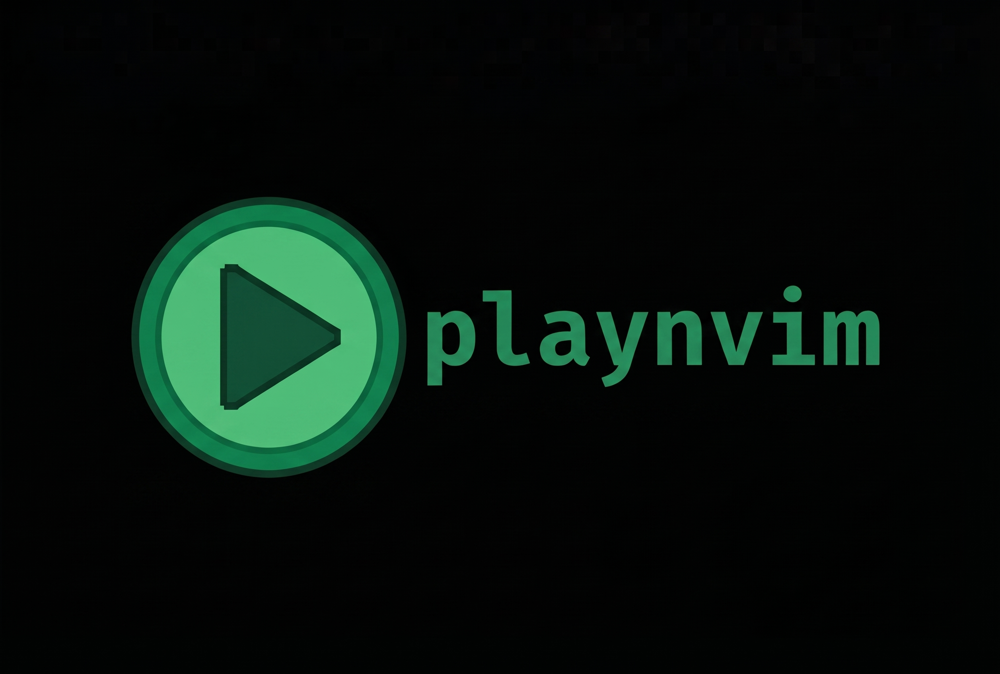
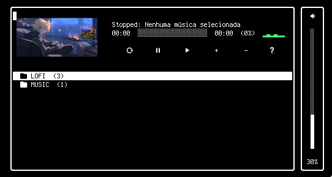
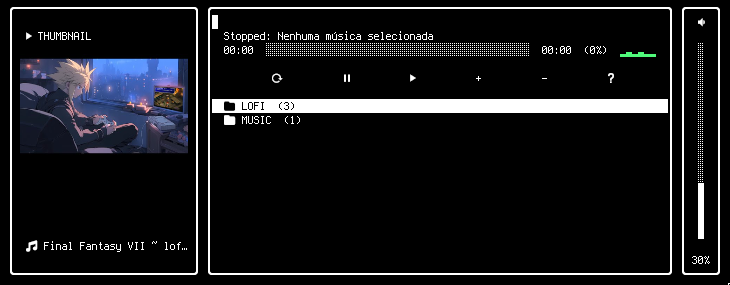
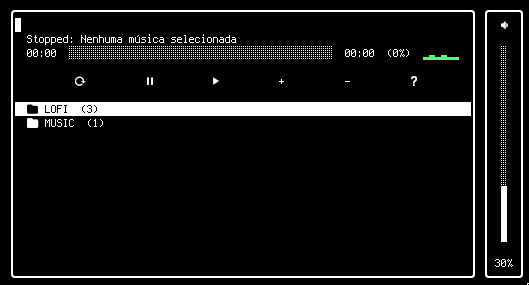

<p align="center">
  
</p>
 
minha motivacao para fazer esse plugins, foi por odiar o algoritmo do youtube ao abrir o youtube e acaaabar me pegando em videos de recomendadcao, mas eu so queria uma musica para ouvir ou
estudar e a merda do algoritmo acaba me pegando, esse plugin foi feito para resovler essa minha indiferenca com o youtube, adicione seus links de musica,audiolivro,lofi,palestras, em forma de
link, podtende tambeem organizar em playlist, e numca mais precisar abrir o youtube para fazer isso apenas manter os links salvos na sua configuracao do nvim

[](https://neovim.io)
[](https://mpv.io)
[](LICENSE)

---

## 🎨 Layout Modes

**playnvim** offers three layout options tailored to your preference and terminal capabilities. Set your default layout in `setup({ layout = "embedded" })` or toggle between them anytime with `:PlayLayout`:

### 1. `embedded` Layout *(Default)*
> Renders the album / video thumbnail directly inside the upper section of the player window.

<p align="center">
  
</p>

### 2. `external` Layout
> Displays a dedicated floating preview window positioned on the left side of the main player.

<p align="center">
  
</p>

### 3. `classic` Layout
> A clean, text-only minimal interface featuring the live equalizer and vertical volume bar. Ideal for any standard terminal emulator.

<p align="center">
  
</p>

---

## 💡 How It Works

**playnvim** spawns a decoupled `mpv` background daemon communicating through a local UNIX IPC socket:
* **Non-blocking**: Neovim never freezes or lags while buffering or fetching YouTube streams.
* **Background Playback**: Close the player window at any time (`q` or `<Esc>`); playback continues uninterrupted in the background.
* **Visual Polish**: Includes real-time progress tracking, an animated two-tier braille/bar equalizer, a dedicated vertical volume fader, and dynamic video cover thumbnails rendered directly inside your terminal using the Kitty Graphics Protocol.

---

## 📦 Requirements & Dependencies

Ensure the following tools are installed on your system:

| Dependency | Purpose | Installation (Linux / macOS) |
|---|---|---|
| **Neovim** (>= 0.9.0) | Text editor | `sudo apt install neovim` / `brew install neovim` |
| **mpv** | Audio backend engine | `sudo apt install mpv` / `sudo pacman -S mpv` / `brew install mpv` |
| **yt-dlp** | YouTube streaming & metadata extraction | `sudo apt install yt-dlp` / `pip install yt-dlp` / `brew install yt-dlp` |
| **sqlite3** *(optional)* | Local caching for cover art thumbnails | `sudo apt install sqlite3` (built-in on most Linux distros and macOS) |

> **Note on Thumbnail Previews**: Cover art rendering uses the Kitty Graphics Protocol. To view album/video thumbnails, use a compatible terminal emulator (such as **Kitty**, **Ghostty**, or **WezTerm**). In other terminals, the player works seamlessly using the classic or external layout mode without images.

---

## 🚀 Installation

### Using `lazy.nvim`

#### Quick Setup:
```lua
{ "DaFi-1/playnvim" }
```

#### Full Setup with General Configuration:
```lua
{
  "DaFi-1/playnvim",
  config = function()
    require("playnvim").setup({
      keymap = "<space>a",   -- Global shortcut to toggle the player window (or false to disable)
      volume = 30,           -- Default initial volume (0 to 100)
      layout = "embedded",   -- Layout style: "embedded" (with cover), "external", or "classic"
      width = 76,            -- Floating window width
      height = 18,           -- Floating window height
      border = "rounded",    -- Border style: "rounded", "single", "double", or "solid"
      auto_next = true,      -- Automatically play the next track when current one finishes
      thumbnail = true,      -- Enable cover art thumbnail preview (Kitty graphics protocol)
      thumb_width = 30,      -- Column width reserved for cover thumbnail
      cookies = "auto",      -- Auto-detect browser cookies (Brave/Chrome/Firefox) for YouTube, or path, or false
      mpv_args = {           -- Additional flags forwarded to the mpv backend
        "--no-video",
        "--ytdl-format=bestaudio/best",
      },
      playlist = {           -- Initial default playlist
        {
          playlist = "LOFI",
          title = "Lofi Hip Hop - Beats to Relax",
          url = "https://www.youtube.com/watch?v=jfKfPfyJRdk",
        },
        {
          playlist = "LOFI",
          title = "Final Fantasy VII LoFi Mix",
          url = "https://www.youtube.com/watch?v=_PEQhKUDRNU",
        },
        {
          playlist = "SYNTHWAVE",
          title = "Synthwave Radio - Chill Synth",
          url = "https://www.youtube.com/watch?v=4xDzrJKXOOY",
        },
        {
          playlist = "LOCAL",
          title = "Local Favorite Track",
          url = vim.fn.expand("~/Music/song.mp3"),
        },
      },
    })
  end,
}
```

---

### Using `packer.nvim`

#### Quick Setup:
```lua
use({ "DaFi-1/playnvim" })
```

#### Full Setup:
```lua
use({
  "DaFi-1/playnvim",
  config = function()
    require("playnvim").setup({
      keymap = "<space>a",
      volume = 30,
      layout = "embedded",
      auto_next = true,
      -- See full options above
    })
  end,
})
```

---

## 🎶 Adding Songs & Playlists

You can organize and customize your music library directly in the `playlist` option of `setup()`.

### Track Structure

Each track is represented by a Lua table:

```lua
{
  playlist = "CATEGORY_OR_FOLDER_NAME", -- Optional: groups tracks in a collapsible folder
  title = "Display Name of the Track", -- Name shown in the player list
  url = "https://... or /path/to/file",  -- YouTube URL or local file path
}
```

### 1. Adding YouTube Streams & Playlists

Simply provide the full YouTube video URL:

```lua
playlist = {
  {
    playlist = "LOFI & CHILL",
    title = "Lofi Girl - Beats to Relax/Study to",
    url = "https://www.youtube.com/watch?v=jfKfPfyJRdk",
  },
  {
    playlist = "LOFI & CHILL",
    title = "Chrono Trigger OST Mix",
    url = "https://www.youtube.com/watch?v=QKrG7nw5cak",
  },
}
```

### 2. Adding Local Audio Files

Local paths can point to any audio format supported by `mpv` (`.mp3`, `.flac`, `.m4a`, `.ogg`, `.wav`, etc.). You can use absolute paths or `vim.fn.expand`:

```lua
playlist = {
  {
    playlist = "MY MUSIC",
    title = "Stairway to Heaven - Led Zeppelin",
    url = "/home/user/Music/stairway_to_heaven.flac",
  },
  {
    playlist = "MY MUSIC",
    title = "Chill Lofi Beat",
    url = vim.fn.expand("~/Music/Beats/track01.mp3"),
  },
}
```

### 3. Folder-Based Organization (Tree View)

When you assign the same `playlist` attribute to multiple tracks, **playnvim** automatically groups them into interactive folders in the UI:

```text
▾ LOFI & CHILL (2)
  󰐊 Lofi Girl - Beats to Relax/Study to
    Chrono Trigger OST Mix
▸ SYNTHWAVE (4)
▸ MY MUSIC (2)
```

* Navigate with `j` / `k` over any folder header.
* Press `<Enter>` on a folder header to **expand** (`▾`) or **collapse** (`▸`) that category.
* Press `<Enter>` on any track to start playing it immediately.

---

## 🎮 Plugin Commands

Run these commands directly in Neovim command-line mode (`:`):

| Command | Description & Usage |
|---|---|
| `:Play` or `:PlayNvim` | Opens the centered player interface |
| `:PlayToggle` | Toggles the player window open or closed |
| `:PlayPause` | Toggles playback between Pause and Resume |
| `:PlayResume` | Resumes playback of the current track |
| `:PlayStop` | Stops playback and resets the engine |
| `:PlayNext` | Skips to the next track in the playlist |
| `:PlayPrev` | Returns to the previous track in the playlist |
| `:PlayVolume <0-100>` | Sets volume directly (e.g. `:PlayVolume 45`) |
| `:PlayLayout [mode]` | Cycles layout or sets: `embedded`, `external`, or `classic` (e.g. `:PlayLayout embedded`) |

*(Backward-compatible aliases `:Music`, `:MusicToggle`, `:MusicPause`, etc. are also available).*
 
## 📄 License

This project is licensed under the **MIT License**. See the [LICENSE](LICENSE) file for complete details.

```text
MIT License

Copyright (c) 2026 DaFi-1

Permission is hereby granted, free of charge, to any person obtaining a copy
of this software and associated documentation files (the "Software"), to deal
in the Software without restriction, including without limitation the rights
to use, copy, modify, merge, publish, distribute, sublicense, and/or sell
copies of the Software, and to permit persons to whom the Software is
furnished to do so, subject to the following conditions:

The above copyright notice and this permission notice shall be included in all
copies or substantial portions of the Software.

THE SOFTWARE IS PROVIDED "AS IS", WITHOUT WARRANTY OF ANY KIND, EXPRESS OR
IMPLIED, INCLUDING BUT NOT LIMITED TO THE WARRANTIES OF MERCHANTABILITY,
FITNESS FOR A PARTICULAR PURPOSE AND NONINFRINGEMENT. IN NO EVENT SHALL THE
AUTHORS OR COPYRIGHT HOLDERS BE LIABLE FOR ANY CLAIM, DAMAGES OR OTHER
LIABILITY, WHETHER IN AN ACTION OF CONTRACT, TORT OR OTHERWISE, ARISING FROM,
OUT OF OR IN CONNECTION WITH THE SOFTWARE OR THE USE OR OTHER DEALINGS IN THE
SOFTWARE.
```
